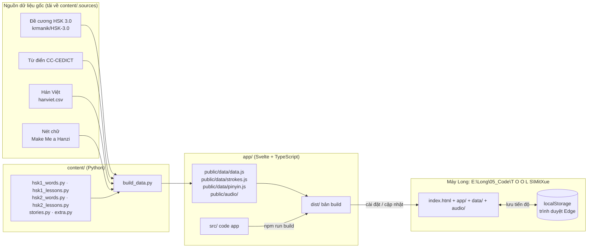
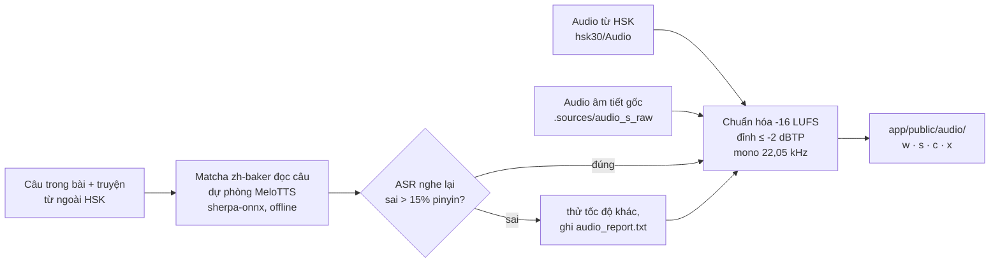
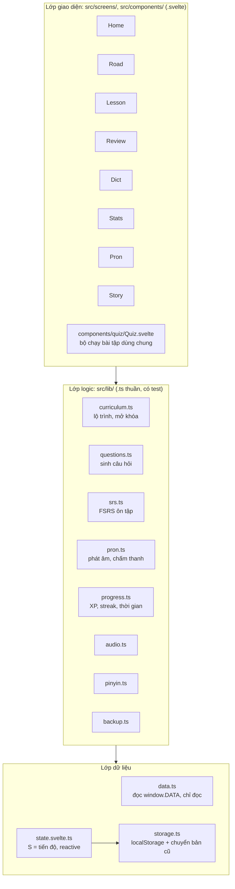
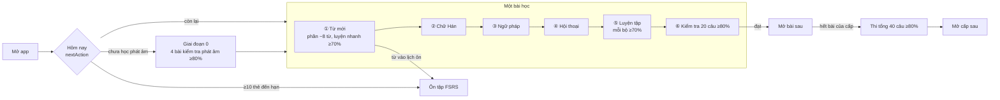
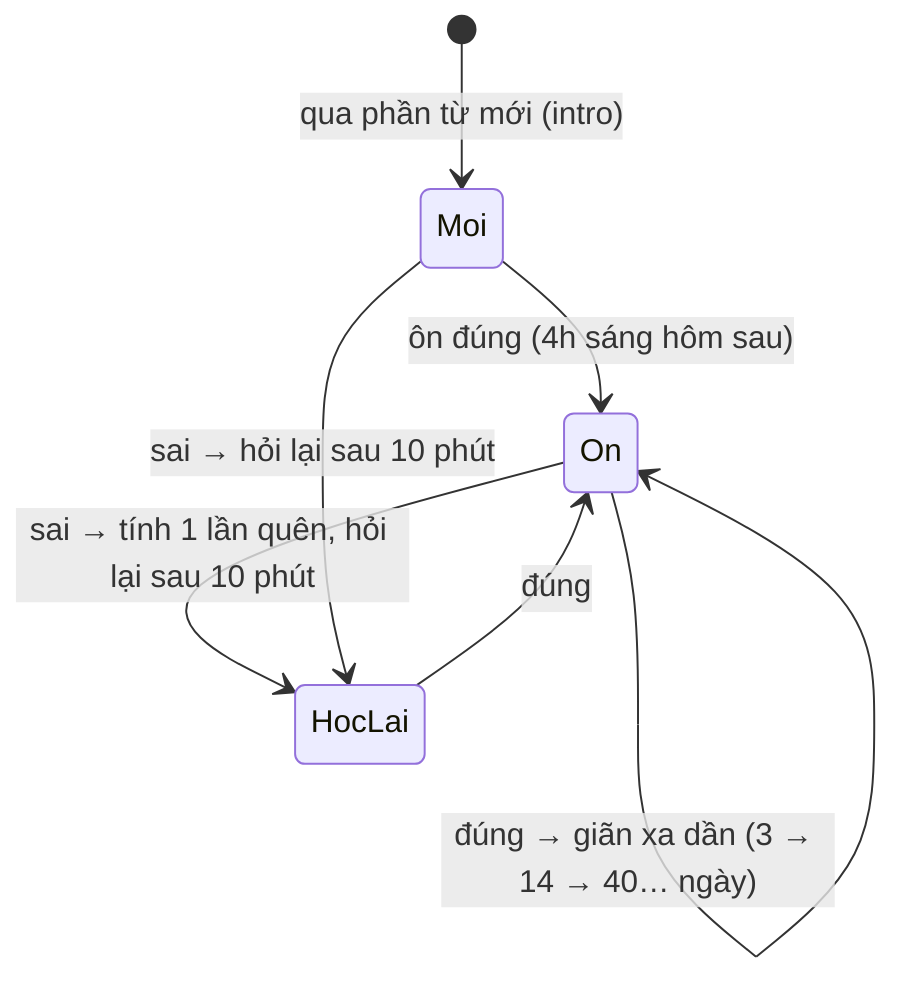
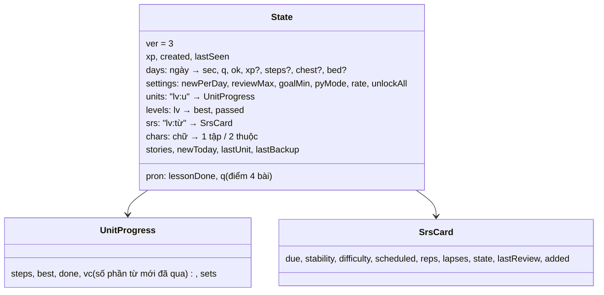

# Kiến trúc Mít Xué (v1.0)

Tài liệu này giải thích app được ghép từ những phần nào, dữ liệu chạy đi đâu, và mỗi file làm gì. Đọc xong phần 1–3 là đủ hình dung; phần 4–7 để tra khi cần sửa.

> Các sơ đồ viết bằng **Mermaid** (một cách viết sơ đồ bằng chữ). VS Code (cài extension "Markdown Preview Mermaid Support") và GitHub đều hiển thị được. Bản hình vẽ sẵn: [`architecture.svg`](architecture.svg).

---

## 1. Bức tranh tổng thể

Mít Xué là một **web app tĩnh chạy offline** (static web app): chỉ có frontend (FE), **không có backend (BE)**, không cần server. Bấm đôi `index.html` (hoặc `MO MIT XUE.bat`) là trình duyệt mở app từ ổ đĩa (giao thức `file://`).

Có 3 khối tách biệt:

| Khối | Thư mục | Viết bằng | Chạy khi nào | Sinh ra |
|---|---|---|---|---|
| **Nội dung** (content pipeline) | `content/` | Python | Khi sửa bài học, từ vựng | `app/public/data/*.js` |
| **Âm thanh** (audio pipeline) | `content/build_audio.py` | Python + ffmpeg + sherpa-onnx | Sau khi sửa nội dung | `app/public/audio/{w,s,c,x}/`, `data/audio-index.js` |
| **App** (frontend) | `app/src/` | TypeScript + Svelte 5 | Khi sửa giao diện, logic | `app/dist/` (bản build) |
| **Bản cài** (deploy) | `T O O L S\MitXue\` trên máy Long | n/a | Khi học | Tiến độ trong trình duyệt (localStorage) |



**Vì sao không có backend?** Long học một mình trên một máy, nên lưu tiến độ ngay trong trình duyệt là đủ, chạy được cả khi mất mạng. Khi cần đồng bộ điện thoại ↔ laptop (bước 2), chỉ cần thay 2 hàm trong `app/src/lib/storage.ts` (xem mục 6).

---

## 1b. Âm thanh



| Thư mục | Nội dung | Nguồn |
|---|---|---|
| `audio/w/` | 3.557 từ HSK | Bộ audio của đề cương HSK 3.0 |
| `audio/s/` | 1.627 âm tiết × thanh (bảng pinyin, luyện nghe) | Bản v0.1, gốc cất ở `.sources/audio_s_raw` |
| `audio/c/` | Mọi câu trong bài học và truyện | Matcha zh-baker (giọng nữ; dữ liệu Biaobei chỉ dùng phi thương mại), dự phòng MeloTTS (MIT); đọc chậm 0,9×. Câu trùng 1 từ HSK dùng audio người thật |
| `audio/x/` | Từ ngoài đề cương dùng trong câu (extra.py) | Matcha / MeloTTS |

**Thứ tự phát câu** (`playSentence` trong `audio.ts`): file `audio/c/` → giọng đọc của trình duyệt (Edge) → ghép audio từng từ. Cái sau chỉ dùng khi cái trước không có hoặc lỗi.

**Độ lớn:** mọi file được đưa về **-16 LUFS** (chuẩn EBU R128, mức thường dùng cho giọng nói/podcast) bằng `loudnorm` 2 lượt, tăng giảm tuyến tính nên không méo tiếng. Kiểm bằng `python3 content/check_audio.py`.

## 2. Bên trong app: các lớp (layers)

Code app chia 3 lớp, lớp trên chỉ gọi lớp dưới, không gọi ngược:



- **Lớp dữ liệu** biết dữ liệu nằm ở đâu và trông thế nào.
- **Lớp logic** là luật học: khi nào mở bài, ra câu hỏi gì, khi nào ôn. Không đụng tới giao diện, nên test được bằng `npm test`.
- **Lớp giao diện** chỉ hiển thị và gọi logic.

Nhờ vậy sửa luật (ví dụ điểm đạt 80% → 75%) chỉ cần đổi 1 dòng trong `curriculum.ts`, không phải lùng trong giao diện.

---

## 3. Luồng học của Long



- Bài HSK 1–2 có đủ 6 bước. Bài HSK 3–5 (chưa có giáo án) chỉ có ① ② ⑤ ⑥.
- Mỗi ngày tối đa `settings.newPerDay` từ mới (mặc định 10). Quá 50 thẻ chờ ôn thì chặn từ mới, bấm "Vẫn học tiếp hôm nay" để bỏ qua.

### Ôn tập FSRS



Thư viện **ts-fsrs** (cùng thuật toán với Anki bản mới) tính khoảng cách, mục tiêu lúc ôn còn nhớ 90%. App bổ sung 2 luật: làm đúng một từ **chưa đến hạn** (trong bài tập) thì không đổi lịch; sai thì hẹn lại sau 10 phút trong ngày.

---

## 4. Bản đồ thư mục

```
mitxue/                         ← repo git
├─ README.md                    cách chạy, lệnh hay dùng
├─ CHANGELOG.md                 lịch sử phiên bản
├─ docs/
│  ├─ ARCHITECTURE.md           (file này)
│  ├─ HOW-TO.md                 công thức sửa những việc hay gặp
│  └─ architecture.svg          sơ đồ hình
├─ content/                     NỘI DUNG (Python)
│  ├─ build_data.py             gom mọi thứ → app/public/data + audio/w
│  ├─ hsk1_words.py             300 từ HSK 1 chia 15 bài (chữ|pinyin|nghĩa)
│  ├─ hsk1_lessons.py           15 bài: hội thoại, ngữ pháp, mẹo
│  ├─ hsk2_words.py             203 từ HSK 2 chia 11 bài
│  ├─ hsk2_lessons.py           11 bài HSK 2
│  ├─ stories.py                truyện đọc thêm
│  ├─ extra.py                  từ ngoài đề cương dùng trong câu + tên bộ thủ
│  ├─ build_audio.py            đọc câu bằng TTS, chuẩn hóa độ lớn mọi file
│  ├─ check_audio.py            đo độ lớn để kiểm tra
│  ├─ audio_report.txt          câu ASR nghe khác chữ gốc (cần nghe lại)
│  └─ .sources/                 dữ liệu gốc tải về (không đưa vào git)
└─ app/                         APP (Svelte 5 + TypeScript + Vite)
   ├─ index.html                khung trang, nạp data/*.js rồi app
   ├─ vite.config.ts            cấu hình build (1 file JS, chạy được file://)
   ├─ public/                   chép nguyên vào bản build
   │  ├─ data/data.js           từ, bài, chữ, truyện (do build_data.py sinh)
   │  ├─ data/strokes.js        nét chữ cho tập viết
   │  ├─ data/pinyin.js         bảng âm tiết hợp lệ
   │  ├─ audio/w/               audio từ (tên = mã băm của chữ)
   │  ├─ audio/s/               audio âm tiết (ma1.mp3, luu4.mp3…)
   │  ├─ audio/c/               audio đọc nguyên câu
   │  ├─ audio/x/               audio từ ngoài HSK
   │  ├─ data/audio-index.js    bảng tra câu/từ → file (build_audio.py sinh)
   │  ├─ MO MIT XUE.bat         mở app bằng Edge
   │  └─ HUONG DAN.txt
   ├─ src/
   │  ├─ main.ts                khởi động
   │  ├─ App.svelte             khung: thanh trên, Mít, điều hướng, màn hình
   │  ├─ lib/                   LOGIC + DỮ LIỆU (xem mục 5)
   │  ├─ components/            mảnh giao diện dùng lại
   │  │  ├─ quiz/               Quiz + 4 dạng câu (chọn, sắp xếp, viết, nói)
   │  │  ├─ Py.svelte           pinyin tô màu theo thanh, có chế độ mờ
   │  │  ├─ RichView.svelte     hiển thị nội dung câu hỏi
   │  │  ├─ WordCard / WordModal / CharBox / WriteModal / Flashcards / SentenceRow
   │  │  └─ TopBar / Mit / Nav / Modal / Toast
   │  ├─ screens/               mỗi màn hình một file
   │  │  ├─ Home, Road, Review, Dict, Stats, Story, LevelTest, Settings
   │  │  ├─ lesson/             Lesson + 6 bước (Vocab, Chars, Grammar, Dialogue, Practice, UnitTest)
   │  │  └─ pron/               Pron + Learn, Chart, Listen, Speak
   │  └─ styles/app.css         toàn bộ CSS (biến màu sáng/tối ở đầu file)
   └─ tests/
      ├─ unit/                  test logic (vitest), chạy bằng npm test
      └─ e2e/run_e2e.py         test bấm thật trên trình duyệt (Playwright)
```

---

## 5. Từng file trong `src/lib/`

| File | Việc | Hàm chính |
|---|---|---|
| `types.ts` | Kiểu dữ liệu: `Word`, `Lesson`, `Sentence`, `State`, `SrsCard`… | — |
| `data.ts` | Đọc `window.DATA`, tạo chỉ mục | `W`, `BY_C`, `wordsOf`, `lessonOf`, `sentsUpTo`, `introducedChars` |
| `pinyin.ts` | Tách âm tiết, thanh điệu, dấu | `splitSyl`, `toneOfSyl`, `markSyl`, `plainSyl`, `noTone` |
| `storage.ts` | Đọc/ghi localStorage, **chuyển dữ liệu bản cũ** | `migrate`, `loadRaw`, `persist`, `blankState` |
| `state.svelte.ts` | `S` = tiến độ (reactive). Sửa `S` xong gọi `save()` | `S`, `save`, `replaceState`, `day` |
| `srs.ts` | Ôn tập FSRS | `intro`, `answer`, `dueKeys`, `dueCount` |
| `curriculum.ts` | Luật lộ trình, mở khóa, chia phần, chặn từ mới | `unitOpen`, `nextUnit`, `nextAction`, `vocabChunks`, `newGate`, hằng `PASS_*` |
| `questions.ts` | Sinh câu hỏi (dữ liệu thuần, không HTML) | `qMeaning`… `unitTestQs`, `levelTestQs`, `practiceSets`, `reviewQs` |
| `pron.ts` | Phát âm: mẹo, câu nghe, khóa 4 bài, **chấm thanh** | `toneQ`, `soundQ`, `PRON_COURSE`, `scoreTone`, `autoCorr` |
| `progress.ts` | XP, cấp, streak, đếm phút học | `addXP`, `lvOf`, `streak`, `logAnswer` |
| `motivation.ts` | Nhiệm vụ ngày + rương, dải 7 ngày, sao của bài, nhắc ngủ 23:00 | `quests`, `openChest`, `lastDays`, `starsOf`, `checkBedtime` |
| `sfx.ts` | Tiếng hiệu ứng tổng hợp bằng Web Audio (tắt được trong Cài đặt) | `sfx.ok`, `sfx.bad`, `sfx.done`, `sfx.reward` |
| `audio.ts` | Phát audio từ, âm tiết, câu (file câu → giọng Edge → ghép) | `playWord`, `playSyl`, `playSentence`, `playAll`, `stopAudio` |
| `router.svelte.ts` | Điều hướng theo `#/...` | `go`, `parse`, `href` |
| `ui.svelte.ts` | Lời Mít, toast, modal, pháo giấy, bảng chúc mừng | `say`, `toast`, `openModal`, `confetti`, `celebrate` |
| `backup.ts` | Sao lưu/khôi phục file JSON | `exportBackup`, `importBackup` |
| `writer.ts` | Khung tập viết (hanzi-writer) | `createWriter` |
| `startup.ts` | Sáng/tối, Mít chào | `applyTheme`, `greet` |
| `actions.ts` | Chế độ 5 phút | `fiveMinute` |
| `debug.ts` | `mitxue` trong Console (F12), chế độ test | `exposeDebug` |

### Địa chỉ (routes)

| Địa chỉ | Màn hình |
|---|---|
| `#/home` | Hôm nay |
| `#/road` | Lộ trình |
| `#/lesson/1/3/grammar` | HSK 1 · Bài 3 · bước Ngữ pháp |
| `#/level-test/2` | Thi tổng HSK 2 |
| `#/review` · `#/review/five` | Ôn tập · chế độ 5 phút |
| `#/pron/learn\|chart\|listen\|speak` | Phát âm |
| `#/story/4` | Truyện số 4 |
| `#/dict` · `#/stats` | Từ điển · Tiến độ |

---

## 6. Dữ liệu tiến độ (State v3)

Lưu ở `localStorage["mitxue_v3"]` (JSON). Khóa cũ `mitxue_v2`/`mitxue_v1` được giữ nguyên, không xóa.



**Đổi cấu trúc dữ liệu thì sao?** Tăng `VERSION` trong `storage.ts` và viết thêm bước chuyển trong `migrate()`, kèm test trong `tests/unit/storage.test.ts`. Không bao giờ xóa khóa cũ.

**Khi làm đồng bộ (bước 2)**: thay `loadRaw()` / `persist()` trong `storage.ts` bằng bản đọc/ghi Firebase (vẫn giữ localStorage làm bản đệm offline). Các phần khác không cần đổi.

---

## 7. Vì sao chạy được khi bấm đôi (file://)

Trình duyệt **chặn** `<script type="module">` và `fetch()` trên `file://`. Nên:

1. Dữ liệu nội dung là **script thường** gán vào `window.DATA`, `window.STROKES`, `window.SYL_RAW` (không dùng `fetch` JSON).
2. Vite build app thành **một file `app/app.js` dạng IIFE**; plugin `mitxue-classic-script` trong `vite.config.ts` đổi thẻ `<script type="module">` thành `<script defer>`.
3. Không chia nhỏ code (`inlineDynamicImports`), CSS gom một file `app/app.css`.

Tiến độ: Chromium/Edge dùng chung localStorage cho mọi file mở bằng `file://` trên cùng máy, nên chuyển thư mục app vẫn giữ tiến độ. **Đổi trình duyệt thì không** → dùng Sao lưu/Khôi phục.

---

## 8. Kiểm thử

| Lệnh | Kiểm gì | Bao lâu |
|---|---|---|
| `npm run check` | Kiểu TypeScript + lỗi Svelte | ~10 s |
| `npm test` | 32 test logic: pinyin, chuyển dữ liệu, FSRS, lộ trình, câu hỏi mọi bài, chấm thanh, audio đủ file | ~3 s |
| `npm run build` | Tạo `dist/` | ~5 s |
| `npm run e2e` | Bot đi hết: phát âm → bài 1 → kiểm tra → ôn → từ điển → truyện → sao lưu → chuyển dữ liệu v0.4, chụp ảnh `tests/e2e/shots/` | ~1 phút |
| `npm run all` | Cả 4 lệnh trên | ~1,5 phút |

Quy tắc: **chạy `npm run all` trước mỗi lần cài bản mới lên máy Long.**
