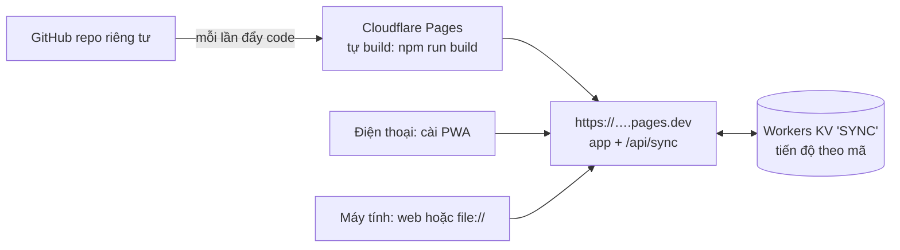

# Đưa Mít Xué lên mạng (Cloudflare Pages + GitHub)

Mục tiêu: có địa chỉ web (`https://mitxue.pages.dev`) để học trên điện thoại, cài như app (PWA),
và đồng bộ tiến độ giữa các máy. Miễn phí.



## Một lần duy nhất (Long làm, ~15 phút)

1. **GitHub**: tạo repo **Private** tên `mitxue` (không thêm README). Báo chị tên tài khoản GitHub → chị đẩy code lên.
2. **Cloudflare**: đăng ký tại dash.cloudflare.com (miễn phí, không cần thẻ).
3. **Tạo kho KV**: Storage & Databases → KV → *Create* → tên `mitxue-sync`.
4. **Tạo trang**: Workers & Pages → Create → **Pages** → *Connect to Git* → chọn repo `mitxue`:
   - Framework preset: **None**
   - Build command: `npm run build`
   - Build output directory: `dist`
   - Root directory (Advanced): `app`
   - Environment variable: `NODE_VERSION` = `22`
   - Bấm *Save and Deploy* (lần đầu ~3–5 phút).
5. **Gắn KV**: vào trang vừa tạo → Settings → **Bindings** → Add → *KV namespace*: tên biến `SYNC`, chọn `mitxue-sync` → Save → Deployments → *Retry deployment* (để API nhận KV).
6. Mở địa chỉ `https://<tên>.pages.dev` → Cài đặt ⚙️ → **Tạo mã** → quét QR bằng điện thoại.

## Sau đó

- Chị sửa app → đẩy lên GitHub → Cloudflare tự build lại. Điện thoại tự nhận bản mới lần mở sau.
- Bản `file://` trên máy tính vẫn chạy như cũ; muốn nó đồng bộ thì điền `SITE_URL` trong `app/src/lib/config.ts`.

## Giới hạn miễn phí (đủ dư cho 1 người)

| Thứ | Giới hạn | Mít Xué dùng |
|---|---|---|
| Pages: số file / kích thước 1 file | 20.000 / 25 MiB | ~6.300 / 18 MB (`pron/wasm.js`) |
| Pages: lượt build | 500 / tháng | vài lượt / tuần |
| Functions (API) | 100.000 lượt / ngày | vài trăm |
| KV ghi | 1.000 / ngày | tối đa ~30 / giờ học (app gom 2 phút/lần) |

## Kiểm tra trước khi đẩy

```bash
cd app
npm run all          # check + unit test + build + e2e (file://)
npm run e2e:web      # giả lập Cloudflare: đồng bộ 2 máy + PWA offline + khung điện thoại
```
